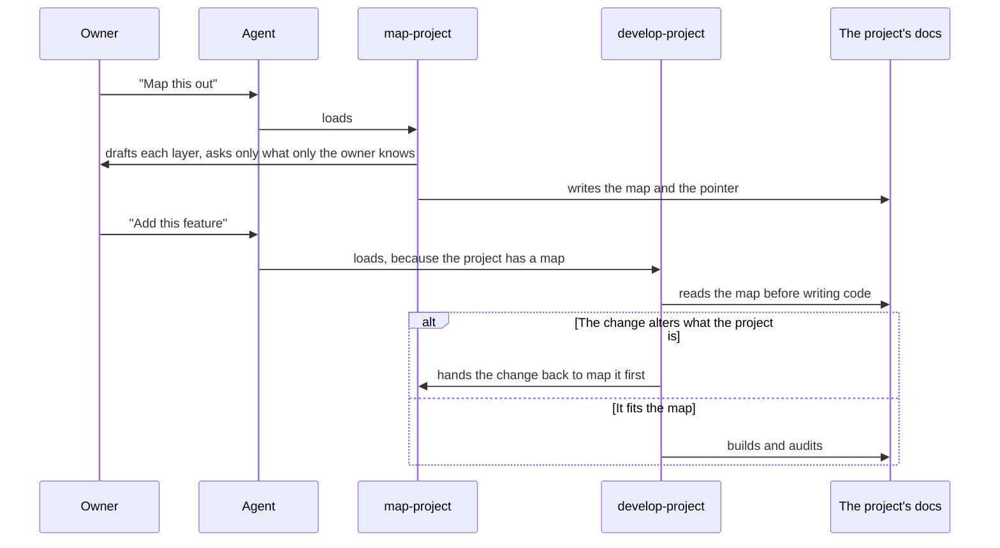

# Skills

Where an agent picks up the method. Each skill is a set of instructions an agent loads when its description matches the work in front of it, and each one starts [capabilities](../primitives/CAPABILITY.md). A project's owner never touches the skills. They talk to the agent.

## Skills

| Skill | Starts | Loads when |
|---|---|---|
| `map-project` | [Map](../capabilities/MAP.md) | Someone wants to start a project, map one out, or change what a mapped project is |
| `develop-project` | [Develop](../capabilities/DEVELOP.md), [Audit](../capabilities/AUDIT.md) | Any work in a project with a map in its docs, or someone asks whether the code still matches the map |

## How it's served

| Host | How the skills arrive |
|---|---|
| Claude Code | As a plugin, from the repository's own marketplace |
| Any agent that reads a skills folder | Linked into that folder |

## Invariants

- **Each skill's description says when it loads.** For `develop-project`, the signal is the project itself: a map in its docs.
- Each capability is started by exactly one skill.
- **The two skills state the method's rules the same way.** A rule both rely on, such as the tests every invariant meets or how the map is written, has one source, and neither skill restates it differently.
- A skill hands over to the other rather than doing its work. `map-project` never builds, and `develop-project` never changes the map on its own.
- A skill that can't do its job says so, and says what would: `develop-project` in a project without a map offers `map-project`.
- The skills behave the same in every host.
